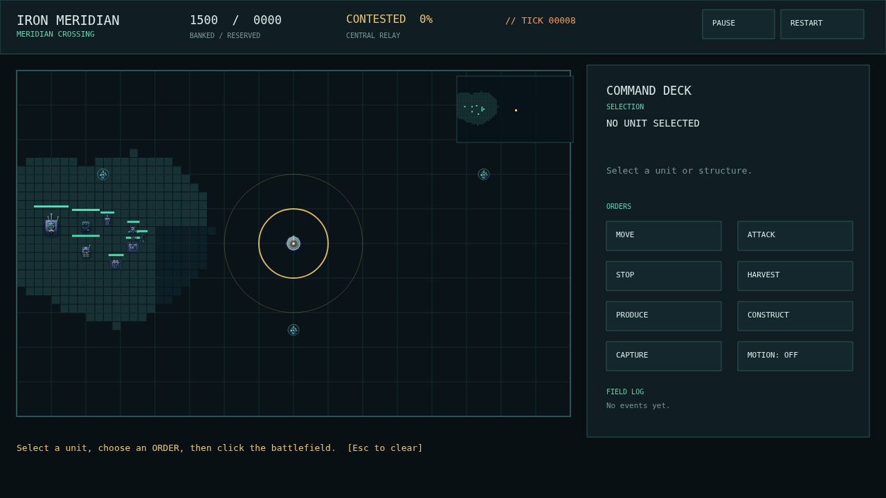

<p align="center">
  
</p>

<p align="center">
  <a href="README.md">English</a> · <strong>简体中文</strong>
</p>

# Iron Meridian

### 一款运行在浏览器里的近未来即时战略原型。

**派出侦察、在经济发展与扩军之间抉择、争夺中央中继站——整套 30 Hz 确定性模拟里，单位、配方和平衡数值都是可读的 YAML 记录。**

> **状态：** V1 已可游玩（`0.1.0`）。当前主动开发已暂停；代码与设计资料继续公开，供研究、复刻与后续开发使用。参见[项目状态](docs/project-status.md)。



## 快速开始

需要 Node.js 20+。

```bash
git clone https://github.com/ZisIsNotZis/iron-meridian.git
cd iron-meridian
npm install
npm run dev
```

打开 Vite 输出的地址。对局从一段可跳过的简报开始。想直接看无头模拟的验证结果？

```bash
npm run test:sim
npm run test:content
npm run test:bench
```

## 现在能做什么

- **打完整一局：** 侦察、采矿、生产、建造、交战、占领中央中继站，胜负结算后可以重开同一张场景。
- **相信模拟结果：** 固定 30 Hz 步进、带种子的随机数、状态摘要；相同种子和命令日志必然复现同一局。
- **面对真正的脚本对手：** 东侧 AI 使用同一套迷雾过滤后的视图，会发展基地、组建合成兵力并争夺目标。
- **运用合成兵种：** 步枪兵、侦察车、主战坦克、反坦克小组、采矿车与 MCV，配合地形、视野、装甲类型和清晰的克制关系。
- **把游戏当数据来改：** `design/content/` 中的 284 份严格 YAML 记录覆盖单位、阵营、地图、配方与设计说明；schema 与校验器会在运行前拦住失效引用。
- **看清战场：** 手绘 SVG 素材、战争迷雾、血条、命令标记、小地图、生产与建造面板、编队、暂停和重开。
- **验证以上说法：** 仓库自带无头模拟自检、内容清单检查、100 实体基准测试和设计文档链接审计。

更多截图见 [`docs/media/`](docs/media/)。

## 架构

```text
design/content + design/schema
             |
             v
        src/content  ---->  src/sim  ---->  observation  ---->  src/app (Phaser)
                              ^                                      |
                              +--------------- commands -------------+
```

- [`design/`](design/) 是唯一事实来源：玩法数据与设计文档都以 YAML 记录存放，并由同目录的 schema 校验。
- [`src/sim/`](src/sim/) 是不依赖引擎的模拟层：确定性状态、命令边界、战斗、经济、迷雾、目标控制与脚本 AI。
- [`src/content/`](src/content/) 为 Node 与浏览器解析并校验内容清单。
- [`src/app/`](src/app/) 是 Phaser 表现层：渲染 observation、把输入翻译成命令，不持有游戏规则。
- [`tools/`](tools/) 与 [`tests/`](tests/) 存放内容校验器、素材渲染器、链接审计、自检与基准测试。

完整设计索引见 [`design/README.md`](design/README.md)，术语表见 [`CONTEXT.md`](CONTEXT.md)。

## 如何开发

```bash
npm install
npm run dev                  # 带热更新的 Phaser 客户端
npm run build                # 生产环境浏览器构建
npm run test:sim             # 确定性无头模拟自检
npm run test:content         # 内容清单解析检查
npm run test:bench           # 100 实体确定性性能基准
node tools/check_content.mjs # 校验全部 YAML 记录与引用
python3 tools/audit_design.py # 审计保留的 Markdown 链接
```

提交 pull request 前，请运行 `npm run test:sim`、`npm run test:content` 和 `node tools/check_content.mjs`。内容改动放在 [`design/content/`](design/content/)，并依据 [`design/schema/`](design/schema/) 校验。

## 如何参与

欢迎提交 issue 和范围明确的 pull request。请写清问题、测试证据；涉及画面改动时附上截图。维护者会审核并合并通过的工作。

修改规则前先读 [`CONTEXT.md`](CONTEXT.md) 和[设计索引](design/README.md)。新的事实应写进它所属的设计记录，不要在多处复制。Agent 可以协助分类、调查、测试、写文档和实现已接受的 issue，但不能绕过维护者审核。

## 路线图

### 0.1.0 已实现

- [x] 确定性无头模拟：命令边界、固定时钟、带种子的随机数和状态摘要。
- [x] 完整对局循环：侦察、经济、生产、建造、战斗、战争迷雾、目标占领、胜负与重开。
- [x] 脚本对手：会采矿、建造、生产混合兵力并推进中继站。
- [x] Meridian Crossing 上的单地图 Coalition 镜像遭遇战。
- [x] 数据驱动的 YAML 内容树，带 schema 校验与引用解析。
- [x] 浏览器客户端：选择、命令、小地图、生产与建造面板、编队、暂停和减少动态效果支持。
- [x] 验证工具链：模拟自检、内容检查、链接审计、素材渲染器和 100 实体基准测试。

### 计划中

- [ ] 近期单人游戏：Coalition 与 Directorate 两个真正不同的阵营、手工编写的战役任务、四张遭遇战地图、不作弊的 AI 难度、存档与检查点、回放、设置、本地化，以及更丰富的素材。
- [ ] 经范围决策后推进的扩展系统：可游玩的 Irregular Network，以及空中、海上与运输层；每一项都必须先通过各自的范围决策。
- [ ] 联机与工具链：多人对战、MCP agent、分布式模组包和排位玩法。

**未来愿景。** V1 用一场镜像遭遇战验证了指挥循环和内容管线。下一步是完整的单人遭遇战游戏：两个真正不同的阵营、手工编写的战役任务、更多地图、存档与回放，以及经过验证的模组路径。再往后——联机、空中与海上层、Irregular Network——都要等各自的设计契约和证据，而不是靠 README 里的一句承诺。

## 许可证

[AGPL-3.0-only](LICENSE)。
